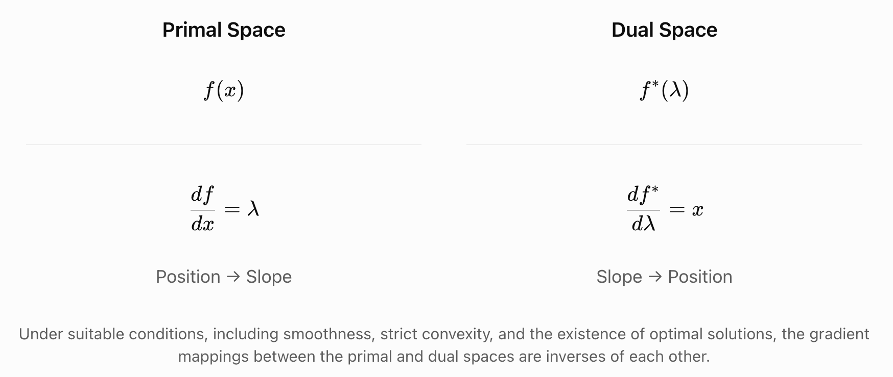

Reinforcement Learning(RL) at the first glance seems much more daunting in comparison to Supervised Fine-Tuning(SFT), and even continues to be so for a quite long time after I tried to approach this concept. I reckon the reason for this may be that RL introduces an additional concept of "environment", and this concept of "environment" brings two more difficulties: 
1. First, RL tends to be viewed more like an experimental science, which leaves such an impression: an entity is throwed into an unknown big world and needs to figure out everything based on interactions, which means it looks like a black box in practice and seems only becoming useful through a bunch of trial and errors; 
2. Second, there are multiple different approachs to understand RL and to derive policy gradient.

All of these make RL obscure. In this blog, I will try to introduce RL from an academic way instead of "trial and error" way, that is, from a perspective of **Optimization Problem**    and to set up the interconnections between different ways of deriving the policy gradient.

# Linear Perturbation and Lagrange's Equation
Given a function $f$, how could we investigate it? One way to do is to add a linear perturbation onto it and see how this function $f$ reacts. In other words, we interpret a function as all the reactions it generates when facing outside perturbations. This is a really interesting perspective: when something cannot be dissected, we learn it by observing how it reacts.

Now we suppose a perfect setting for the below discussion.
A good characteristic this approach brings is that, for the original problem:
$$
\min f(x)
$$
the solution $x^*$ is **fixed**, however via introducing linear perturbation, we can transfer the problem into a new one:
$$
\min [f(x)-\lambda x]
$$
and obviously in this setting we can control what solution $x^*$ to be generated by tweaking $\lambda$. 

In fact we even know that $f'(x^*) = \lambda$, so actually we have a reverse function:
$$
x^*(\lambda)=\operatorname*{arg\,min}_{x} (f(x)-\lambda x)
$$
Based on this reverse function, we can further define a new function:
$$
f^*(\lambda) = \lambda x^*(\lambda) - f(x^*(\lambda))
$$
Take the derivative of $f^*$ we have:
$$
\frac{df^*}{d\lambda} = x^*(\lambda) + \textcolor{blue}{\lambda} \frac{dx^*}{d\lambda} - \textcolor{blue}{f'(x^*(\lambda))}\frac{dx^*}{d\lambda}
$$
Because $\lambda=f'(x^*(\lambda))$, the second and third term cancel, so we have $\frac{df^*}{d\lambda} = x^*(\lambda)$. Therefore we get a perfect relationship:

So we can view the linear perturbation as a coordinate transformation from $x$ to $p$, that is why we call $f^*$ the dual function of $f$, and we can even recover $f$ by taking the dual function of $f^*$, that is $f=f^{**}$.

Now we can discuss how we can derive lagrange's equation based on everything above. Suppose we have an optmization problem:
$$
\begin{aligned}
\min_x \quad & f(x) \\
\text{s.t.} \quad & h(x)=0        
\end{aligned}
$$
We cannot calculate $f$'s derivative and set it to $0$ directly because we have a constraint here. What we gonna do? First, we want to transfer it into a new problem without constraints. To do so, first define a delta function:
$$
\delta(u) =
\begin{cases}
0, & u = 0 \\
\infty, & \text{otherwise}
\end{cases}
$$
and then we rewrite the problem as:
$$
\min_x f(x) + \delta(h(x))
$$
We do not have constraints anymore and obviously solution $x^*$ to this new problem must obey the original constraint $h(x^*)=0$, otherwise the expression will be $\infty$.

Next, we gonna use $f=f^{**}$ to re-express $\delta(u)$:
$$
\begin{aligned}
\delta^*(\lambda) &= \sup_u\{\lambda u - \delta(u)\} = 0 \\
\delta^{**}(u) &= \sup_\lambda \{u\lambda - \delta^*(\lambda)\} = \sup_\lambda\{\lambda u\}
\end{aligned}
$$
therefore, we can extend original $\delta(u)$, and finally have the lagrange equation:
$$
\min_x\max_\lambda f(x) + \lambda h(x)
$$

# Reinforcement Learning Is Secretly An Optimization Problem

First, let us briefly revise the setting of RL. An **Agent** is thrown into a **World**(or Environment), and it always faces a specific state of world, which we denote as $s$. Facing the state $s$, agent takes an action $a$, and the environment will respond to the action with a reward $r(s, a)$ and transfers to a new state $s'$ with probability $\mathbb{Pr}(s'|s, a)$(we can view this as the action $a$ has its influence on the world, changing the state of the world).

Therefore an agent will naturely deduce a "trajectory" $\tau$ when it continuously interacts with the environment:
$$
\tau :s_0 \to a_0 \to s_1 \to a_1 \to ... \to s_{T-1} \to a_{T-1} \to s_T \to ...
$$
and we call the way agent interacts with the environment as **Policy** $\pi$, where $\pi(a|s)$ denotes the probability that the agent will take action $a$ when facing state of environment $s$. Under this setting, the goal of RL can be expressed as:
$$
\underset{\tau\sim(s_0, a_0, ...)}{\mathbb{E}} \left[\sum\limits_t^{\infty} \gamma^tr(s_t, a_t)\right]
$$
here $\gamma$ is the discounted variable, as we discount the reward gotten in the far future.

Besides **Trajectory**, we have another way to see this, that is the **Occupation Measure**. Instead of using trajectories $\tau$ as the fundemantal elements, we can change the view to consider $(s, a)$, state-action pairs, as fundemantal elements. We wanna count the probability that we end up at $(s, a)$ after we interact with environment based on policy $\pi$ for sufficently many rounds, and we denote it as $\mu_\pi(s, a)$. 

Now after changine the view, we can re-express the goal of RL as:
$$
\max \sum\limits_{s, a} \mu_\pi(s, a)r(s, a)
$$
However, remember $\mu_\pi(s, a)$ denotes the probability we end up at $(s, a)$, then there is a parity between the probability **into** $(s, a)$ and the probability **out of** $(s, a)$, this parity can be written as:
$$
\rho_0(s) + \gamma\sum\limits_{s', a'} \mathbb{Pr}(s|s', a')\mu_\pi(s', a') = \sum\limits_{a}\mu_\pi(s, a)
$$
where the left part of the equation above is the probability into $(s, a)$ and $\rho_0$ indicates the initial probability that the agent sees state $s$ and the right part is the probability out of $(s, a)$.

So we can structure the RL problem as an optimization problem:
$$
\begin{aligned}
\max_{\mu_\pi} \quad
& \sum\limits_{s,a} \mu_\pi(s,a)r(s,a) \\
\text{s.t.} \quad
& \rho_0(s) + \gamma\sum\limits_{s',a'} \mathbb{Pr}(s \mid s',a')\mu_\pi(s',a')
= \sum\limits_a \mu_\pi(s,a) \quad \forall s
\end{aligned}
$$

In the following, we want to rephrase the problem in a more neat way, that is the Linear Space. Suppose $\mathcal{S}$ is the state space and $\mathcal{A}$ is the action space, then define two linear space:
$$
\begin{aligned}
X &= \mathbb{R}^{\mathcal{S}\times\mathcal{A}} \\
Y &= \mathbb{R}^{\mathcal{S}}
\end{aligned}
$$
then obviously $\mu_\pi$ and $r$ are functions in space $X=\{f:\mathcal{S}\times\mathcal{A}\rightarrow\mathbb{R}\}$, while $\rho$ is a function in space $Y$. Further we notice we could define some operators:
$$
T(\mu_\pi)(s) = \sum\limits_{a} \mu_\pi(s, a)
$$
Here $T: X \rightarrow Y$ is an operator, it takes in a function in space $X$ and outputs a function in space $Y$, so does the operator $D$:
$$
D(\mu_\pi)(s) = \gamma\sum\limits_{s',a'} \mathbb{Pr}(s \mid s',a')\mu_\pi(s',a')
$$
We can further combine $T$ and $D$ to define $B$:
$$
B = T - D
$$
With all of these, we can rewrite the problem as:
$$
\begin{aligned}
\max_{\mu \geq 0} \quad & \langle r, \mu_\pi \rangle_X \\
\text{s.t.} \quad & B\mu_\pi = \rho_0
\end{aligned}
$$
summation becomes inner product, and via introducing a new variable $V$(later we will see this is exactly the state-value function, but now it is just a normal variable), we transfer it into:
$$
\max\limits_{\mu \geq 0}\inf\limits_V\langle \mu_\pi, r \rangle_X + \langle V,  \rho - B\mu_\pi \rangle_Y
$$
rearrange each term we can have:
$$
\begin{aligned}
&= \langle \mu_\pi, r \rangle - \langle V, B\mu_\pi \rangle + \langle V, \rho \rangle
\end{aligned}
$$
using the fact that we can transfer an operator in inner product term, we have:
$$
\begin{aligned}
&= \langle \mu_\pi, r \rangle - \langle B^*V, \mu_\pi \rangle + \langle V, \rho \rangle \\
&= \langle V, \rho \rangle + \langle \mu_\pi, r - B^*V \rangle
\end{aligned}
$$
and actually we can explicitly write out why we can transfer the operator:
$$
\begin{aligned}
\langle V,B\mu\rangle
&=\sum_s V(s)\left[\sum_a\mu(s,a)-\gamma\sum_{s',a'}\mathbb{Pr}(s\mid s',a')\mu(s',a')\right]\\
&= \sum_{s, a}V(s)\mu(s, a) - \gamma \sum_s \sum_{s', a'} \mathbb{Pr}(s|s', a')\mu(s', a')V(s)\\
&= \sum_{s, a}\left(V(s)\mu(s, a) - \gamma \sum_{s'}\mathbb{Pr}(s'|s, a)\mu(s, a)V(s')\right)\\
&= \sum_{s, a}\mu(s, a)\textcolor{blue}{\left(V(s)-\gamma\sum_{s'}\mathbb{Pr}(s'|s, a)V(s')\right)}\\
&=\langle \mu, \textcolor{blue}{B^*V}\rangle
\end{aligned}
$$
And actually we can try to interpret this transformation, expression $V(s)-\gamma\sum_{s'}\mathbb{Pr}(s'\mid s,a)V(s')$ is the gap between the value when we are at state $s$.
Now, the problem can be expressed as:
$$
\max\limits_{\mu \geq 0}\inf\limits_V\langle V, \rho \rangle + \langle \mu_\pi, r - B^*V \rangle
$$
In order to make sure the problem solvable under $\max\limits_{\mu \geq 0}$, we must have $B^*V \geq r$, otherwise the problem will diverge to infinity. This is actually the **Bellman Equation**:
$$
V(s)\geq\gamma\sum_{s'}\mathbb{Pr}(s'\mid s,a)V(s')+r(s, a)
$$

# Optimization Problem Is An Easier Way to Derive Policy Gradient
